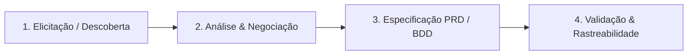

# 📘 Guia Prático de Engenharia de Requisitos

## Do Problema à Solução Arquitetada

Um guia essencial para Product Managers, Tech Leads e Engenheiros de Software que desejam estruturar levantamento de requisitos de forma profissional, eliminando retrabalho e ambiguidades.

---

## 1. As 4 Fases do Ciclo de Requisitos



### 1.1 Elicitação
- **Técnica 1: Entrevistas com Stakeholders:** Foco em entender a *dor* e não a solução prescrita.
- **Técnica 2: Shadowing / Observação:** Observar o usuário realizando o trabalho no ambiente real.
- **Técnica 3: Wireframes no Papel (Low-Fi):** Rascunhar fluxos rápidos no bloco de notas para validar com o usuário antes de tocar em código.

### 1.2 Análise e Priorização (MoSCoW & RICE)
- **Must Have:** Sem isso, o produto não pode ser lançado (core funcional).
- **Should Have:** Muito importante, mas há alternativas temporárias se for necessário postergar.
- **Could Have:** Desejável ("Nice-to-have"), implementado se houver tempo e folga no sprint.
- **Won't Have (nesta versão):** Explicitamente fora do escopo para proteger a data de entrega.

### 1.3 Especificação com BDD (Behavior-Driven Development)
Evite requisitos genéricos como "O sistema deve ser intuitivo". Especifique em formato verificável:

```gherkin
Funcionalidade: Busca dinâmica de projetos
  Cenário: Filtro em tempo real por termo parcial
    Dado que estou no Dashboard de Projetos com 10 projetos cadastrados
    Quando digito "TaskMaster" no campo de busca
    Então a listagem deve filtrar em menos de 100ms exibindo apenas cartões com esse título
```

### 1.4 Rastreabilidade
Cada requisito funcional (RF) deve se conectar diretamente a:
1. Uma dor documentada na persona.
2. Um componente de tela ou endpoint de API.
3. Um conjunto de testes automatizados (Unit / E2E).
